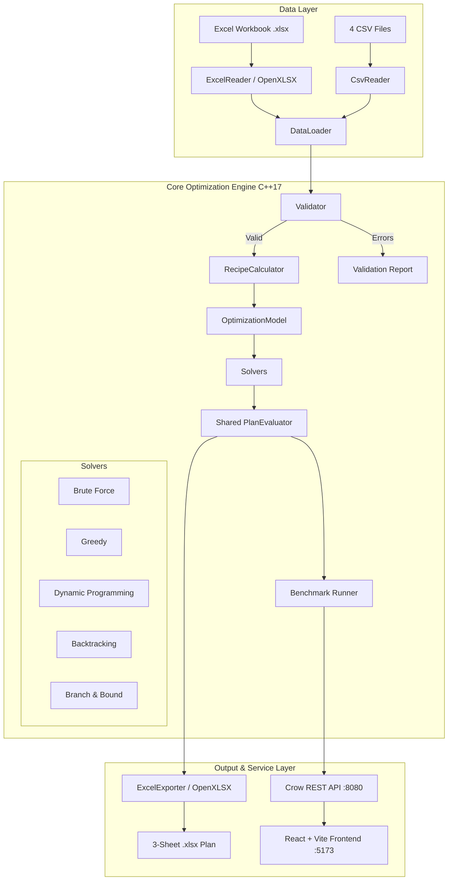

# SmartMeal Optimizer — Project Architecture & Technical Documentation

## 1. Executive Summary

**SmartMeal Optimizer** is a production-grade, full-stack decision-support and meal-planning optimization platform built in modern C++ (C++17) with an interactive React + Vite web dashboard. The application formulates and solves weekly meal plan scheduling under strict nutritional, dietary, budget, and recipe-repetition constraints across three distinct objective modes:

1. **Nutrition Mode**: Minimize normalized deviation from four explicit daily macronutrient targets (Calories, Protein, Carbs, Fat).
2. **Budget Mode**: Minimize actual weekly purchase expenditure, taking existing pantry inventory into account.
3. **Variety Mode**: Maximize the number of distinct recipes used during the seven-day period.

All five optimization algorithms—**Brute Force**, **Greedy Heuristic**, **Dynamic Programming (DP)**, **Recursive Backtracking**, and **Branch & Bound**—are hand-implemented in C++ without external solver or optimization libraries.

---

## 2. System Architecture

### 2.1 Backend Architecture (C++17)

The C++ backend is structured into modular layers:

- **Data Models (`include/models.h`, `include/optimization_config.h`)**:
  POD structures for ingredients, recipes, recipe-ingredient relationships, inventory, calculated recipes, meal plans, and evaluation results.
- **Data Ingestion (`include/csv_reader.h`, `include/excel_reader.h`, `include/data_loader.h`)**:
  RFC 4180-compliant CSV reader and OpenXLSX-based Excel workbook parser.
- **Validation Engine (`include/validator.h`)**:
  Enforces all hard data integrity rules (unique IDs, non-negative nutritional and cost values, valid dietary classifications, referential integrity between recipes and ingredients).
- **Recipe Calculator (`include/recipe_calculator.h`)**:
  Computes per-serving cost, calories, protein, carbs, and fat for each recipe before search execution.
- **Optimization Model (`include/optimization_model.h`)**:
  Defines 7-day slot structures (2, 3, or 4 meals per day), pre-filters eligible candidate recipes based on meal types, dietary restrictions, and ingredient exclusions, and computes admissible heuristic bounds.
- **Shared Evaluator (`include/plan_evaluator.h`)**:
  The central source of truth for feasibility checking, inventory net purchase cost calculations, objective score evaluation, and lexicographical tie-breaking.
- **Five Core Algorithms**:
  - `brute_force.cpp`: Full odometer-based combinatorial enumeration with search-space capping.
  - `greedy.cpp`: Deterministic, mode-specific greedy selection.
  - `dynamic_programming.cpp`: Memoized multi-dimensional state compression with discrete macro keys.
  - `backtracking.cpp`: Depth-first search with forward-looking nutritional feasibility pruning.
  - `branch_and_bound.cpp`: Best-first search using a priority queue with admissible lower bounds for cost and deviation.
- **Benchmark Runner (`include/benchmark.h`)**:
  Executes all five algorithms sequentially against identical problem instances, recording execution time, peak memory, nodes explored, branches pruned, and optimality gaps.
- **Excel Exporter (`include/excel_exporter.h`)**:
  Generates clean, professional `.xlsx` workbooks containing `Weekly_Meal_Plan`, `Nutritional_Summary`, and `Grocery_List`.
- **REST API Server (`include/api.h`, `src/api.cpp`)**:
  High-performance Crow HTTP server exposing 10 REST endpoints with CORS support.

---

## 3. Data Flow & Lifecycles

1. **Upload & Load**:
   - The user uploads an `.xlsx` workbook or four separate CSV files via the web dashboard.
   - `DataLoader` invokes `ExcelReader` or `CsvReader`.
2. **Validation & Calculation**:
   - `Validator` performs structural checks. If fatal errors exist, loading halts with detailed diagnostics.
   - `RecipeCalculator` computes per-serving metrics for all valid recipes and attaches them to `Dataset.calculated_recipes`.
3. **Problem Formulation**:
   - `OptimizationModel` constructs the slot definitions (14, 21, or 28 slots).
   - Ineligible recipes (due to diet category or user-specified exclusions) are pre-filtered.
4. **Optimization Execution**:
   - The user triggers either a single algorithm or the full benchmark suite.
   - Each algorithm navigates the candidate space subject to execution limits (timeout: 10s default, max nodes: 1M default).
   - Every candidate complete plan is evaluated by `PlanEvaluator::evaluate()`.
5. **Display & Export**:
   - The Crow API returns full JSON responses to the React frontend.
   - Visualizations (Chart.js) display nutritional adherence, budget breakdown, and benchmark comparisons.
   - The user exports the final plan to a 3-sheet Excel workbook.

---

## 4. Algorithm Comparison & Complexity

| Algorithm | Completeness | Optimality Guarantee | Time Complexity | Memory Complexity | Best Use Case |
|---|---|---|---|---|---|
| **Brute Force** | Exhaustive | Optimal (within caps) | \(O(R^{S})\) | \(O(S)\) | Small candidate subsets, verification baseline |
| **Greedy** | Incomplete | Feasible (not proven) | \(O(S \cdot R)\) | \(O(S)\) | Instant real-time baseline (< 1 ms) |
| **Dynamic Programming** | Complete | Optimal for discrete states | \(O(S \cdot N_{states} \cdot R)\) | \(O(S \cdot N_{states})\) | Nutrition mode with discretization |
| **Backtracking** | Complete | Optimal (pruned) | \(O(R^{S})\) worst | \(O(S)\) | Exact search with aggressive constraint pruning |
| **Branch & Bound** | Complete | Optimal (provable) | \(O(R^{S})\) worst | \(O(B \cdot S)\) | High-performance exact optimization |

*Legend*: \(S\) = total meal slots (14 to 28), \(R\) = candidate recipes per slot, \(N_{states}\) = reachable state count, \(B\) = active search branches in priority queue.

---

## 5. Frontend Architecture (React 18 + Vite)

- **UI Framework**: React 18, Vite build tool, Lucide React icons, Chart.js + React-ChartJS-2.
- **Routing**: `react-router-dom` with 5 main views:
  1. `Dashboard`: High-level summary of active plan, key metrics, and quick actions.
  2. `MealsPage`: Daily meal schedule, nutritional breakdown charts, grocery list, and Excel export.
  3. `AlgoPage`: Comprehensive benchmark comparison table, execution time & node comparison charts, and algorithm explanations.
  4. `DatasetPage`: File upload (Excel & CSV), validation diagnostics, ingredient catalogue, and recipe browser.
  5. `SettingsPage`: Full optimization configuration (diet type, weekly budget, calorie/macro bounds, explicit targets, exclusions).
- **Design System**: Modern, clean responsive design with custom CSS design tokens (`frontend/src/styles/global.css`), accessible color contrasts, and data density.

---

## 6. Mathematical Formulation Summary

See `MATHEMATICAL_FORMULATION.md` for full formal proofs and bounds.

- **Primary Nutrition Objective**:
  \[
  \min D = \frac{1}{28}\sum_{d=0}^{6}\sum_{n \in \{Cal, Prot, Carb, Fat\}} \frac{|Actual_{d,n} - Target_n|}{\max(Target_n, 10^{-6})}
  \]
- **Primary Budget Objective**:
  \[
  \min \sum_{i \in Ingredients} \max(0, Required_i - Available_i) \times Price_i
  \]
- **Primary Variety Objective**:
  \[
  \max |\{ \text{Recipe\_ID} \in \text{Plan} \}|
  \]
- **Tie-Breaking Rule**:
  Lexicographical ordering: Primary Objective \(\rightarrow\) Net Purchase Cost \(\rightarrow\) Nutritional Deviation \(\rightarrow\) Lexicographical Recipe IDs.

